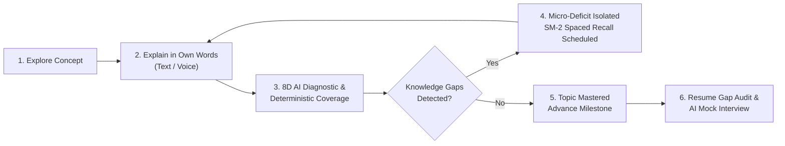
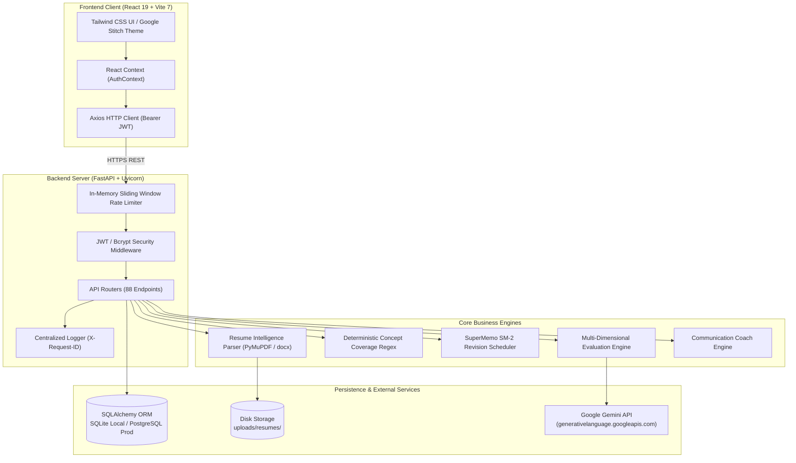
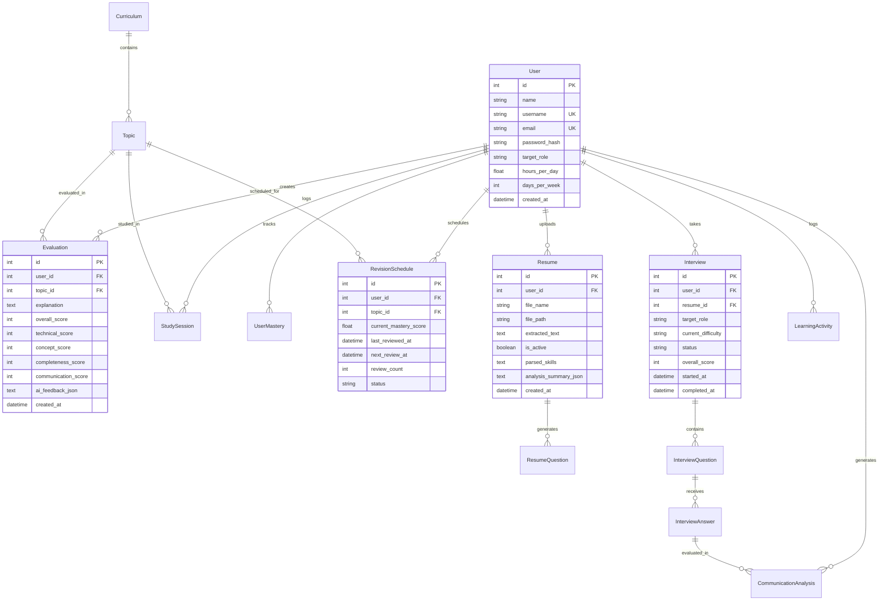
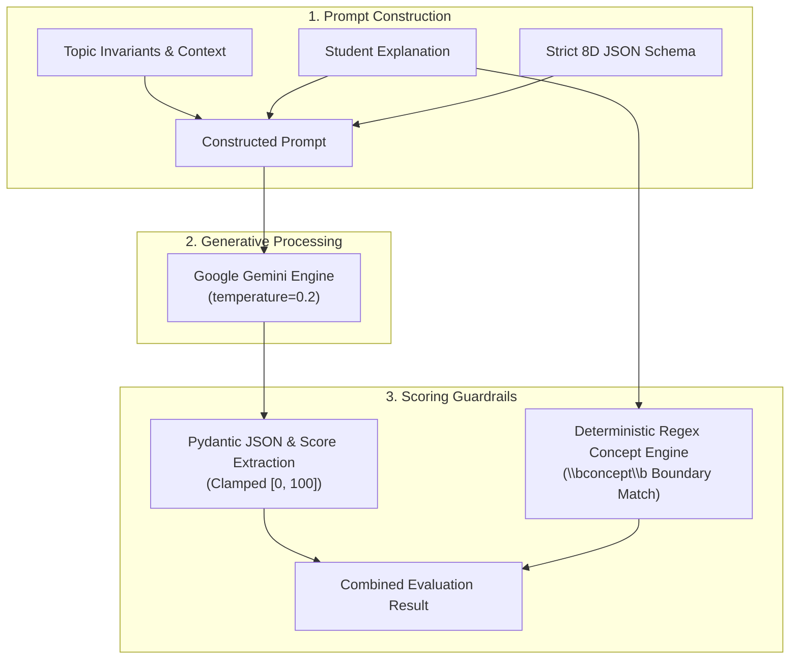
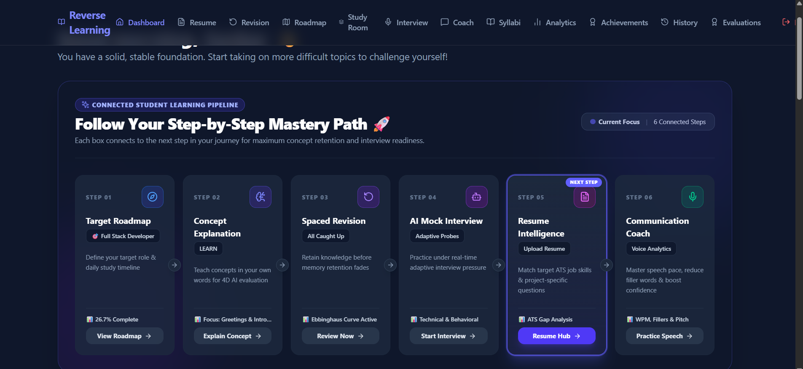

# Reverse Learning Studio

### Adaptive Cognitive Diagnostic, Spaced Repetition & Career Intelligence Platform

[](https://github.com/anusha-2024-aia/reverse-learning-app/actions/workflows/ci.yml)

**Reverse Learning Studio** is a full-stack educational and career readiness platform built on the **Feynman Technique**: shifting students from passive consumption (videos, multiple-choice recognition drills) to active conceptual articulation. By challenging learners to explain complex computer science, software engineering, and systems concepts in their own words via text or speech, the system combines **Google Gemini generative AI** with a **deterministic mathematical concept coverage engine** to evaluate technical depth, isolate micro-level knowledge deficits, schedule active recall intervals, and conduct resume-targeted mock interviews.

---

## 1. Problem Statement

Traditional online technical education suffers from critical structural shortcomings that hinder long-term retention and workforce readiness:

- **The Illusion of Competence:** Passive learning (reading documentation, watching tutorials, answering multiple-choice questions) tests recognition rather than recall. Students frequently believe they understand an architectural concept until asked to articulate it from first principles or implement it in high-stakes interviews.
- **Undetected Micro-Level Knowledge Gaps:** Standard assessments grade submissions binary-style (pass/fail) without isolating whether a failure was caused by algorithmic misunderstanding, syntax unfamiliarity, missing edge-case invariants, or terminology confusion.
- **Rapid Memory Decay (The Ebbinghaus Forgetting Curve):** Without targeted, algorithmically spaced review sessions, technical retention drops precipitously within 48 to 72 hours following initial exposure.
- **Disconnected Career Readiness:** University curriculums rarely bridge academic theory with industry requirements. Students graduate without an objective audit of how their resume projects map to technical interview rubrics or where their demonstrable technical gaps lie.

---

## 2. Proposed Solution

Reverse Learning Studio resolves these problems through an integrated, closed-loop **Reverse Learning Cycle**:



1. **Student Explains from First Principles:** Instead of answering multiple-choice questions, students select topics across 9 core tracks and articulate core invariants in their own words.
2. **Dual-Layer Evaluation:** Submissions are analyzed simultaneously by an 8-dimension generative AI rubric and a deterministic concept-coverage regex algorithm that guarantees reproducible scoring.
3. **Automated Deficit Remediation:** Sub-concept failures trigger automated knowledge gaps categorized by severity (*Mild*, *Moderate*, *Severe*) and populate the student's active recall queue.
4. **Smart Spaced Repetition (SuperMemo SM-2):** Mastery reviews are automatically scheduled at increasing intervals ($1 \text{ day} \rightarrow 6 \text{ days} \rightarrow I \times EF$), reinforcing retention before memory decay occurs.
5. **Resume Intelligence & Adaptive Mock Interviews:** Students upload their actual technical resumes (`.pdf` / `.docx`) to audit skill gaps against real engineering job descriptions and participate in adaptive technical mock interviews with real-time speech and communication coaching.

---

## 3. Project Objectives

- **Operationalize Active Articulation:** Provide an interactive environment where students build deep mental models by explaining concepts simply and rigorously.
- **Deliver Multi-Dimensional Cognitive Feedback:** Evaluate explanations across 8 distinct criteria (Technical Accuracy, Conceptual Understanding, Completeness, Concrete Examples, Relevance, Communication, Grammar, and Vocabulary).
- **Enforce Strict Multi-Tenant Data Isolation:** Ensure every registered student begins with a clean profile (0% mastery, 0-day streak) and that personal evaluations, resumes, and interview attempts remain strictly isolated from other users and the demo persona.
- **Bridge Education to Employment:** Analyze resume artifacts, highlight missing track benchmarks, and conduct technical interviews with adaptive difficulty scaling.

---

## 4. Key Value Proposition

| Dimension | Traditional Learning Platforms | Reverse Learning Studio |
| :--- | :--- | :--- |
| **Primary Interaction** | Passive video watching & multiple-choice drills | Active text/voice explanation using the Feynman Technique |
| **Scoring Mechanism** | Binary answer key matching | 8-dimension qualitative AI rubric + deterministic concept coverage metric |
| **Knowledge Gap Tracking** | Coarse module-level percentages | Micro-level misconception isolation with actionable remediation advice |
| **Memory Reinforcement** | Static bookmarking or linear re-reading | Algorithmic spaced repetition (SuperMemo SM-2) categorized into due queues |
| **Interview Preparation** | Generic LeetCode questions | Personalized adaptive mock interviews driven by candidate resume projects |
| **Communication Feedback** | None | Real-time speech rate (WPM), filler word tracking, and structural feedback |

---

## 5. Detailed Feature Documentation

The application is structured into three primary hubs containing 14 core modules and 2 extended engines:

### Academic Hub

#### 1. Student Dashboard
- **Purpose:** Centralized operational overview of student cognitive mastery, retention streaks, active gaps, and daily learning milestones.
- **Workflow:** Upon logging in, queries `/api/dashboard-data` using the student's JWT token. Calculates an aggregated weighted mastery index ($40\%$ technical, $20\%$ communication, $30\%$ interview, $10\%$ consistency).
- **New User Experience:** Registered students start with an empty onboarding state: `0% Cognitive Mastery`, `0 Days Streak`, `0 Priority Knowledge Gaps`, and clean call-to-actions.
- **Implementation Status:** **Fully Implemented & Verified**.

#### 2. Knowledge Diagnostic and Gap Analysis
- **Purpose:** Granular diagnosis of conceptual weaknesses and misinterpretations before exams or technical interviews.
- **Workflow:** Evaluates user explanations via `POST /api/evaluate`. Scores below $70\%$ automatically generate persistent `knowledge_gaps` records, sorted by severity (*Severe*, *Moderate*, *Mild*).
- **Implementation Status:** **Fully Implemented & Verified**.

#### 3. Topic Exploration and Deep AI Explanations
- **Purpose:** Curriculum exploration across 9 computer science tracks containing 100+ structured engineering topics.
- **Workflow:** Students browse topics via `/api/topics` and can ask targeted questions to the AI Tutor via `POST /api/topics/{id}/ask-ai`. The backend formats prompt instructions to explain core invariants, edge cases, and architectural failure modes. If the Gemini API reaches quota or rate limits, the system automatically falls back to pedagogical heuristics without crashing.
- **Implementation Status:** **Fully Implemented & Verified**.

#### 4. Smart Revision Engine
- **Purpose:** Spaced repetition scheduling based on the Ebbinghaus memory curve to eliminate the forgetting curve.
- **Workflow:** Tracks concepts in the `revision_schedules` table. Displays queues for *Due Today*, *Overdue*, and *Upcoming*. When a student completes a review drill, the SM-2 algorithm calculates new intervals and mastery deltas (e.g. $+12.5\%$).
- **Implementation Status:** **Fully Implemented & Verified**.

### Career Engine

#### 5. AI Resume Intelligence and Gap Audit
- **Purpose:** Extraction and technical gap auditing of candidate resumes against engineering competencies.
- **Workflow:** Accepts `.pdf` and `.docx` files up to 10 MB via `POST /api/resume/upload`. Validates magic numbers, enforces a 50-byte minimum file size, stores files safely in `backend/uploads/resumes/` using UUID-prefixed filenames, extracts text via PyMuPDF/docx, and structures technical skills, project entries, and experience into database records.
- **Data Isolation:** Enforces strict user ownership; attempts by other users to query `/api/resume/{id}` return `HTTP 404 Access Denied`.
- **Implementation Status:** **Fully Implemented & Verified**.

#### 6. AI Mock Interview Simulation and Voice Studio
- **Purpose:** Real-time adaptive technical mock interviews evaluating systems knowledge and behavioral communication.
- **Workflow:** `POST /api/interview/start` initiates an interview session (Technical, Behavioral, Resume, or Mixed). Candidates submit answers via text or Web Speech API recording via `POST /api/interview/answer`. The adaptive engine scales difficulty (*Easy* $\rightarrow$ *Medium* $\rightarrow$ *Hard*) dynamically based on performance.
- **Implementation Status:** **Fully Implemented** (Browser microphone capture depends on physical client hardware; speech-to-text logic verified).

#### 7. Virtual Study Room and Live Focus
- **Purpose:** Structured Pomodoro and deep-work focus sessions with integrated topic objectives.
- **Workflow:** Provides 25m, 45m, and 60m focus timers with Pause, Resume, and Reset controls. Completing a session posts to `POST /api/sessions/live-focus`, logging duration, objectives, and reflections directly into `study_sessions` and `learning_activities`.
- **Implementation Status:** **Fully Implemented & Verified**.

#### 8. Learning History and Performance Analytics
- **Purpose:** Longitudinal telemetry tracking learning velocity, study consistency, and cognitive trends.
- **Workflow:** Queries `/api/analytics?range=30d`. Renders 30-day activity calendars, topic mastery bars, score trends, and goal progression. Empty states are gracefully handled when `has_enough_data: false`.
- **Implementation Status:** **Fully Implemented & Verified**.

#### 9. AI Communication Coach (Extended Engine)
- **Purpose:** Objective speech analytics measuring verbal delivery, speaking pace, and filler word frequency.
- **Workflow:** Analyzes submitted transcripts and audio duration via `POST /api/communication/analyze`. Tracks Words Per Minute (WPM), flags verbal filler patterns (*"um"*, *"like"*, *"basically"*), and evaluates clarity and grammatical structure.
- **Implementation Status:** **Fully Implemented & Verified**.

#### 10. Adaptive Learning Roadmap (Extended Engine)
- **Purpose:** Dynamically re-sequencing curriculum milestones based on real-time diagnostic performance.
- **Workflow:** Tracks milestones in `roadmaps` and `roadmap_items`. Automatically reorders prerequisite topics when severe knowledge gaps are detected.
- **Implementation Status:** **Fully Implemented & Verified**.

### Account & Authentication Management

#### 11. Student Registration
- **Purpose:** Clean onboarding for new students.
- **Workflow:** Validates format, trims whitespace, hashes passwords with bcrypt, checks email uniqueness in SQLite/PostgreSQL, and registers the student. Starts with completely blank input fields and immediately clears stale validation errors when the user edits fields.
- **Implementation Status:** **Fully Implemented & Verified**.

#### 12. Student Login
- **Purpose:** Secure authentication and session issuance.
- **Workflow:** Verifies credentials against stored bcrypt hashes. On success, issues a signed stateless HS256 JWT access token stored in browser session/local storage.
- **Implementation Status:** **Fully Implemented & Verified**.

#### 13. 1-Click Demo Account (Sign In as Maya Lin)
- **Purpose:** Evaluator and recruiter sandbox mode.
- **Workflow:** Authenticates the pre-seeded persona *Maya Lin* (`maya.lin@berkeley.edu`) with 84% cognitive mastery, a 14-day streak, Berkeley resume analysis, and full evaluation history. Demo data is strictly isolated from normal registered users.
- **Implementation Status:** **Fully Implemented & Verified**.

#### 14. Student Profile and Settings
- **Purpose:** Customizing engineering target tracks, daily study availability, and experience levels.
- **Workflow:** Retrieves and updates profile parameters via `GET/PUT /api/auth/profile`.
- **Implementation Status:** **Fully Implemented & Verified**.

#### 15. Forgot Password and Account Recovery
- **Purpose:** Self-service password reset.
- **Workflow:** `POST /api/auth/forgot-password` generates a 6-digit recovery token; `POST /api/auth/reset-password` verifies the token and securely updates the user's password hash.
- **Implementation Status:** **Fully Implemented & Verified**.

#### 16. Logout and Session Management
- **Purpose:** Secure termination of client sessions.
- **Workflow:** Clears tokens from storage and revokes client authentication state, redirecting unauthenticated users to `/login`. Protected routes automatically redirect unauthenticated attempts.
- **Implementation Status:** **Fully Implemented & Verified**.

---

## 6. System Architecture

Reverse Learning Studio utilizes a clean, decoupled 2-tier architecture separating the React SPA from the FastAPI backend and persistent storage layers:



### Architectural Highlights

1. **Client Layer:** Modular React 19 Single Page Application styled with Tailwind CSS, utilizing React Router v7 and Lucide React icons. All authenticated screens share a persistent sidebar and topbar (`StitchLayout`).
2. **Security & Rate Limiting:** An in-memory sliding-window rate limiter prevents abuse on authentication (`10 req/min`), AI evaluation (`5 req/min`), and resume upload (`3 req/min`) endpoints before business logic execution.
3. **Dual-Layer Evaluation Pipeline:** Combines qualitative LLM analysis with a deterministic regex-based concept coverage metric, preventing LLM score hallucinations from dictating knowledge gap detection.
4. **Resilient Document Pipeline:** Extracts resume text and structures JSON schemas with automated fallbacks to rule-based pattern matching if external AI endpoints are unavailable.
5. **Multi-Tenant Database Isolation:** Every query explicitly enforces `user_id == current_user.id`.

---

## 7. Technology Stack

### Frontend
- **Framework & Runtime:** React `19.2.0`, Vite `7.3.1`
- **Routing:** React Router DOM `7.18.2`
- **Styling & Design System:** Tailwind CSS `4.2.1` with custom dark navy/cyan Stitch theme
- **Icons:** Lucide React `0.575.0`
- **Data Visualization:** Recharts `3.10.1` (Mastery trends, activity calendars, gap severity breakdowns)
- **HTTP Client:** Axios `1.13.5` with request/response interceptors for Bearer token injection
- **Testing:** Vitest `4.1.11`, React Testing Library `16.3.3`, jsdom `29.1.1`
- **Linting:** ESLint `9.39.1`

### Backend
- **Framework & ASGI:** Python `3.11` / `3.12`, FastAPI `0.115+`, Uvicorn
- **ORM & Database:** SQLAlchemy `2.0+` supporting SQLite (Local Development) and PostgreSQL (Production via `psycopg2-binary`)
- **Authentication & Security:** `python-jose` (HS256 JWT tokens), `passlib` with `bcrypt` password hashing, `email-validator`
- **Document Processing:** PyMuPDF (`fitz`) for PDF parsing, `python-docx` for Microsoft Word documents
- **AI Client SDK:** `openai` SDK mapped to Google Generative Language endpoint (`https://generativelanguage.googleapis.com/v1beta/openai/`)
- **Testing:** Python `unittest` & `pytest` with `httpx` ASGI TestClient

---

## 8. Database Design

The data layer is managed via SQLAlchemy ORM. All personal learning and career records maintain foreign key relationships to the `users` table:



### Data Ownership & Query Isolation

Every database query accessing user data enforces parameterized user filtering:

```python
# Guaranteed User-Isolated Query Pattern
records = db.query(models.Evaluation).filter(
    models.Evaluation.user_id == current_user.id,
    models.Evaluation.genuine_predicate()
).order_by(models.Evaluation.created_at.desc()).all()
```

---

## 9. Project Structure

```text
reverse-learning-app/
├── .github/
│   └── workflows/
│       └── ci.yml               # GitHub Actions CI workflow (Python & Node tests)
├── backend/
│   ├── app/
│   │   ├── ai_service/          # Gemini API prompt templates & client configuration
│   │   ├── core/                # Error handlers, logging configuration, custom exceptions
│   │   ├── routes/              # Modular FastAPI route controllers (88 endpoints)
│   │   ├── services/            # Pure business logic (SM-2, coverage, resume parsing, analytics)
│   │   ├── auth.py              # JWT encoding/decoding, get_current_user dependency
│   │   ├── database.py          # SQLAlchemy engine, session maker, DB URL normalizer
│   │   ├── main.py              # FastAPI app initialization, CORS, lifespan topics seed
│   │   ├── models.py            # SQLAlchemy relational database models (22 tables)
│   │   ├── rate_limiter.py      # Zero-dependency in-memory sliding-window rate limiter
│   │   └── schemas.py           # Pydantic request & response models
│   ├── tests/                   # 140 automated backend unit, integration, and security tests
│   ├── uploads/                 # Local directory for user-uploaded resumes
│   ├── .env.example             # Template for backend environment variables
│   ├── requirements.txt         # Python package dependencies
│   ├── run_all_tests.py         # Master test runner executing full verification suite
│   └── study.db                 # SQLite local developer database
├── frontend/
│   ├── src/
│   │   ├── api/                 # Axios client instance with auth interceptors
│   │   ├── components/          # Reusable UI widgets, dashboard cards, modals, layout
│   │   │   ├── dashboard/       # Connected student pipeline, metrics, welcome section
│   │   │   ├── layout/          # Persistent StitchLayout (Sidebar, Topbar, Mobile Drawer)
│   │   │   ├── resume/          # Resume upload dropzone, interview modal
│   │   │   └── revision/        # Smart revision card, active recall modal
│   │   ├── context/             # React Context providers (AuthContext)
│   │   ├── pages/               # 18 Page components (Dashboard, StudyRoom, MockInterview, etc.)
│   │   └── tests/               # 12 Vitest frontend test suites (39 tests)
│   ├── .env.example             # Template for frontend environment variables
│   ├── eslint.config.js         # ESLint 9 configuration
│   ├── package.json             # Node dependencies and build scripts
│   ├── vite.config.js           # Vite build and test configuration
│   └── index.html               # Web application entry point
├── README.md                    # Project documentation
└── .gitignore                   # Git exclusion patterns
```

---

## 10. Installation and Local Setup

### Prerequisites

- **Python:** `3.11` or `3.12` installed (`python --version`)
- **Node.js:** `18.0.0` or higher (`node -v`)
- **npm:** `9.0.0` or higher (`npm -v`)
- **Git:** Installed on system (`git --version`)

---

### Step 1: Clone Repository

```bash
git clone https://github.com/anusha-2024-aia/reverse-learning-app.git
cd reverse-learning-app
```

---

### Step 2: Backend Setup

1. **Navigate to the backend directory:**
   ```bash
   cd backend
   ```

2. **Create and activate a virtual environment:**
   - **Windows (PowerShell):**
     ```powershell
     python -m venv venv
     .\venv\Scripts\Activate.ps1
     ```
   - **Linux / macOS:**
     ```bash
     python3 -m venv venv
     source venv/bin/activate
     ```

3. **Install Python dependencies:**
   ```bash
   pip install -r requirements.txt
   ```

4. **Configure environment variables:**
   ```powershell
   Copy-Item .env.example .env   # On Windows
   # cp .env.example .env        # On Linux/macOS
   ```
   Generate a cryptographic secret key for JWT signing:
   ```bash
   python -c "import secrets; print(secrets.token_urlsafe(32))"
   ```
   Update `backend/.env`:
   ```env
   GEMINI_API_KEY=your_gemini_api_key_here
   DATABASE_URL=sqlite:///./study.db
   SECRET_KEY=your_generated_secret_key_here
   JWT_ALGORITHM=HS256
   ACCESS_TOKEN_EXPIRE_MINUTES=1440
   FRONTEND_URL=http://localhost:5173,http://127.0.0.1:5173
   ```

5. **Start the FastAPI server:**
   ```bash
   python -m uvicorn app.main:app --host 127.0.0.1 --port 8000 --reload
   ```
   *The backend will be running at `http://127.0.0.1:8000` with Swagger docs at `http://127.0.0.1:8000/docs`.*

---

### Step 3: Frontend Setup

Open a **separate terminal window**, return to project root, and navigate to `frontend`:

```bash
cd frontend
```

1. **Install Node dependencies:**
   ```bash
   npm install
   ```

2. **Configure environment variables:**
   ```powershell
   Copy-Item .env.example .env   # On Windows
   # cp .env.example .env        # On Linux/macOS
   ```
   Verify `frontend/.env` contains:
   ```env
   VITE_API_URL=http://127.0.0.1:8000
   ```

3. **Start the Vite development server:**
   ```bash
   npm run dev
   ```
   *The web application will be accessible at `http://127.0.0.1:5173/`.*

---

## 11. Environment Variables Matrix

### Backend (`backend/.env`)

| Variable | Purpose | Required? | Default / Notes |
| :--- | :--- | :--- | :--- |
| `GEMINI_API_KEY` | Secret key for Google Gemini generative AI API | **Yes** (for AI features) | Fallbacks to rule-based engine if omitted |
| `DATABASE_URL` | SQLAlchemy connection URL | **Yes** | `sqlite:///./study.db` (Local) / `postgresql://...` (Prod) |
| `SECRET_KEY` / `JWT_SECRET` | Cryptographic secret for signing JWT tokens | **Yes** | Must be high-entropy 32+ character string |
| `JWT_ALGORITHM` | JWT signature algorithm | No | `HS256` |
| `ACCESS_TOKEN_EXPIRE_MINUTES` | Token session expiration window | No | `1440` (24 Hours) |
| `FRONTEND_URL` | Allowed origin(s) for CORS policy | No | `http://localhost:5173,http://127.0.0.1:5173` |
| `AI_EVALUATION_RATE_LIMIT` | Sliding window rate limit for AI evaluations | No | `5` (requests per minute per user) |
| `INTERVIEW_RATE_LIMIT` | Sliding window rate limit for mock interviews | No | `5` (requests per minute per user) |
| `DOCUMENT_RATE_LIMIT` | Sliding window rate limit for resume uploads | No | `3` (requests per minute per user) |
| `AUTH_RATE_LIMIT` | Sliding window rate limit for login/register | No | `10` (requests per minute per IP) |

### Frontend (`frontend/.env`)

| Variable | Purpose | Required? | Default / Notes |
| :--- | :--- | :--- | :--- |
| `VITE_API_URL` | Base endpoint URL for Axios backend requests | **Yes** | `http://127.0.0.1:8000` |

---

## 12. API Documentation

The backend exposes 88 REST endpoints across functional modules. Comprehensive OpenAPI documentation is interactive at `http://127.0.0.1:8000/docs`.

### Authentication & Account (`/api/auth`)
- `POST /api/auth/register` — Register a new student account (No Auth).
- `POST /api/auth/login` — Authenticate credentials and receive Bearer JWT token (No Auth).
- `POST /api/auth/demo-login` — 1-Click Fast Pass for Maya Lin demo account (No Auth).
- `GET /api/auth/me` — Retrieve current authenticated user profile (`Bearer JWT`).
- `GET /api/auth/profile` — Retrieve full student settings and engineering track (`Bearer JWT`).
- `PUT /api/auth/profile` — Update student name, hours/day, target track (`Bearer JWT`).
- `POST /api/auth/forgot-password` — Generate a 15-minute password reset recovery token (No Auth).
- `POST /api/auth/reset-password` — Reset password using verified recovery token (No Auth).

### Academic Learning & Evaluations (`/api`)
- `GET /api/dashboard-data` — Aggregated dashboard metrics, streak, and recent activity (`Bearer JWT`).
- `POST /api/evaluate` — Submit concept explanation for 8D AI evaluation (`Bearer JWT`, Rate Limited).
- `GET /api/evaluations/mine` — Retrieve authenticated user's genuine evaluation history (`Bearer JWT`).
- `GET /api/evaluations/{id}` — Retrieve detailed dimension scores for an evaluation (`Bearer JWT`).
- `GET /api/knowledge-gaps` — Retrieve detected knowledge gaps sorted by severity (`Bearer JWT`).
- `GET /api/dashboard/knowledge-gap` — Retrieve single weakest topic recommendation (`Bearer JWT`).
- `GET /api/topics` — List all educational topics, optionally filtered by curriculum (`Public`).
- `GET /api/topics/{id}` — Retrieve topic detail and curriculum metadata (`Public`).
- `POST /api/topics/{id}/ask-ai` — Submit question to AI Tutor for architectural deep dive (`Public`).

### Smart Revision Engine (`/api/revisions`)
- `GET /api/revisions` — Retrieve categorized active recall queues (Overdue, Due Today, Upcoming) (`Bearer JWT`).
- `GET /api/revisions/summary` — Retrieve revision statistics (`Bearer JWT`).
- `POST /api/revisions/{topic_id}/complete` — Submit recall explanation and recalculate SM-2 interval (`Bearer JWT`).

### Career Engine & Resume Intelligence (`/api/resume`, `/api/interview`)
- `POST /api/resume/upload` — Upload and parse `.pdf`/`.docx` resume (`Bearer JWT`, Rate Limited).
- `GET /api/resume/active` — Retrieve current user's active resume and extracted skills (`Bearer JWT`).
- `POST /api/interview/start` — Initiate an adaptive mock interview session (`Bearer JWT`, Rate Limited).
- `POST /api/interview/answer` — Submit interview answer, evaluate response, and scale difficulty (`Bearer JWT`).
- `GET /api/interview/history` — Retrieve past completed mock interview reports (`Bearer JWT`).
- `POST /api/sessions/live-focus` — Log virtual study room deep-work session (`Bearer JWT`).
- `GET /api/analytics` — Comprehensive longitudinal telemetry and learning analytics (`Bearer JWT`).

---

## 13. AI Implementation

Reverse Learning Studio integrates AI where generative capabilities provide high pedagogical value, combined with deterministic mathematical guardrails:



### Deterministic Concept Coverage Metric
Independent of LLM prompt non-determinism, the concept coverage engine calculates:
$$\text{Concept Coverage \%} = \left( \frac{\text{covered\_concepts}}{\text{required\_concepts}} \right) \times 100$$
Using word-boundary regular expressions (`\b`), preventing false positives (e.g. "inherit" matching "inheritance").

### Resiliency & Rate Limiting
If the Google Gemini API key is missing or encounters a `403/429` quota exception, the system catches the error, logs a warning with request tracing, and transparently executes a rule-based evaluation parser, ensuring the student application never crashes.

---

## 14. Testing and Quality Assurance

The application features a comprehensive test suite covering all functional layers, multi-user isolation, API schemas, and UI components:

```bash
# 1. Run Master Backend Test Suite (140 Tests)
cd backend
python run_all_tests.py
python -m unittest tests.test_production_verification_gate

# 2. Run Frontend Test Suite (39 Tests across 12 Suites)
cd frontend
npm test

# 3. Run Code Quality Linter (0 Errors, 0 Warnings)
npm run lint

# 4. Verify Production Build Bundle
npm run build
```

### Verified Test Matrix

| Layer | Test Suite | Tests Run | Result | Execution Time |
| :--- | :--- | :--- | :--- | :--- |
| **Backend Unit & System** | `run_all_tests.py` | 56 | **PASS (100%)** | 34.4s |
| **Backend Feature & Security** | Data isolation, auth, resume, sessions | 76 | **PASS (100%)** | 27.0s |
| **Backend Pre-Production Gate**| Workflows 1–7 & BOLA access attack | 8 | **PASS (100%)** | 14.5s |
| **Frontend Vitest Suites** | 12 component, navigation, & auth suites | 39 | **PASS (100%)** | 26.1s |
| **Frontend ESLint** | Complete codebase | 0 errors | **PASS** | 4.2s |
| **Vite Production Bundle** | 2,409 modules transformed | Built | **PASS** | 14.9s |
| **Total Automated Tests** | **Full Stack** | **179** | **179 Passed** | — |

---

## 15. Security and Data Privacy

- **Password Hashing:** Passwords are never stored in plain text; encrypted using `bcrypt` with automated salt generation.
- **Stateless JWT Authorization:** Access tokens expire after 24 hours (`1440` minutes) and are cryptographically verified using HS256 and server-side secret keys.
- **Broken Object-Level Authorization (BOLA) Defense:** Direct requests to `/api/resume/{id}` or `/api/evaluations/{id}` verify that the record's `user_id` matches the authenticated `current_user.id`. Unauthorized cross-user requests receive an immediate `HTTP 404 Access Denied`.
- **File Upload Security:** Uploads are restricted to `.pdf` and `.docx`, capped at 10 MB, validated for a 50-byte minimum size, and sanitized to prevent directory traversal attacks (`../`).
- **OWASP Security Headers:** The FastAPI request middleware automatically injects `X-Content-Type-Options: nosniff`, `X-Frame-Options: DENY`, `Referrer-Policy: strict-origin-when-cross-origin`, and `X-XSS-Protection: 1; mode=block`.
- **Sensitive Log Scrubbing:** Passwords, JWT secrets, and Gemini API keys are scrubbed before logging.

---

## 16. Current Development Status & Future Roadmap

### Currently Developed & Verified Features
- Full student registration, login, and 1-click isolated demo mode.
- 8-dimension cognitive evaluation engine with deterministic concept coverage.
- Automated micro-level knowledge gap detection with severity sorting.
- SuperMemo SM-2 spaced repetition revision queues.
- Resume parsing (`.pdf` / `.docx`) and technical skill extraction.
- Adaptive AI mock interviews with difficulty scaling.
- Virtual study room with configurable focus timers and persistent logging.
- Longitudinal learning analytics with 30-day activity calendars.
- Fully responsive Stitch dark navy navigation (desktop sidebar + mobile drawer).

### Future Roadmap
- **Production Cloud Storage:** Support AWS S3 / Google Cloud Storage buckets for resume uploads alongside local disk storage.
- **Live Collaborative Study Rooms:** WebRTC-powered multi-user study rooms with peer video and shared Pomodoro timers.
- **Enterprise LMS Integration:** LTI 1.3 compliance for synchronizing assignments with Canvas and Blackboard.
- **Native Mobile Apps:** React Native client supporting offline review cards.

---

## 17. Screenshots and Visual Preview

### Student Dashboard & Knowledge Pipeline
*Comprehensive student intelligence dashboard showing cognitive mastery, retention streak, priority gaps, and active recall queue.*



---

## 18. Contribution Guidelines

Contributions are welcome! To contribute:

1. Fork the repository (`git fork`).
2. Create your feature branch (`git checkout -b feature/cognitive-enhancement`).
3. Commit your changes (`git commit -m 'feat: add cognitive milestone analytics'`).
4. Ensure all tests pass (`python run_all_tests.py` and `npm test`).
5. Push to the branch (`git push origin feature/cognitive-enhancement`).
6. Open a Pull Request detailing the changes and verification results.

---

## 19. License

This project is licensed under the MIT License. Developed for **Reverse Learning Studio** — Empowering students to achieve genuine conceptual mastery through active articulation.
