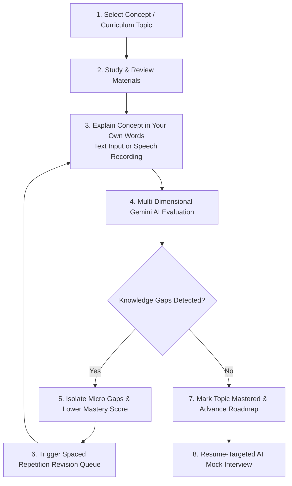
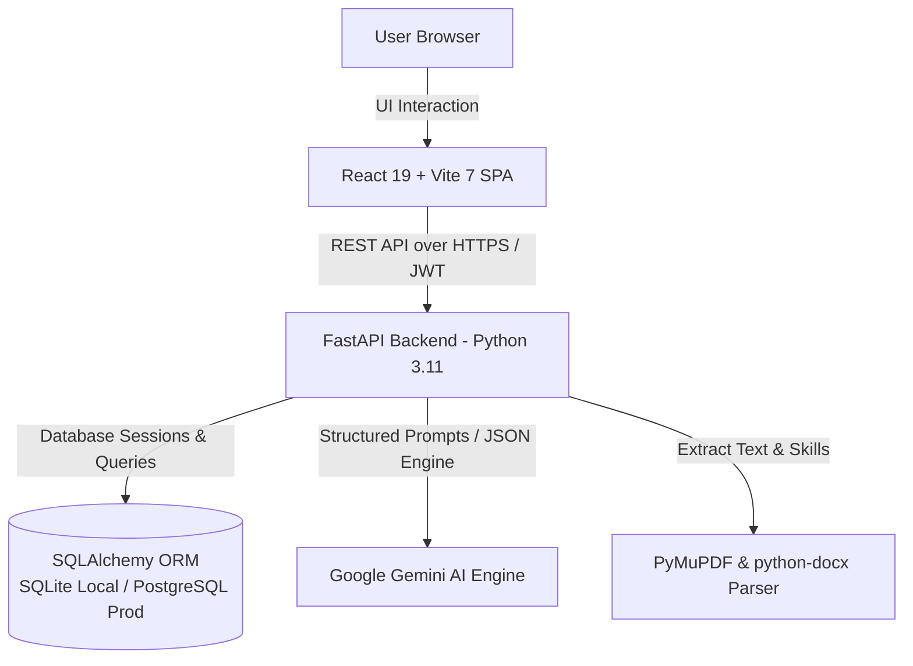

# Reverse Learning Studio

### AI-Powered Feynman Technique & Learning Intelligence Platform

[](https://github.com/anusha-2024-aia/reverse-learning-app/actions/workflows/ci.yml)

**Reverse Learning Studio** is an adaptive learning intelligence platform designed to replace passive memorization with active conceptual mastery using the Feynman Technique. By asking students to teach technical concepts in their own words via text or speech, the system utilizes Google Gemini AI to evaluate explanation depth, isolate micro-level knowledge gaps, dynamically adjust learning roadmaps, and conduct resume-targeted mock interviews.

---

## 🔗 Quick Links

- 📁 **GitHub Repository:** [anusha-2024-aia/reverse-learning-app](https://github.com/anusha-2024-aia/reverse-learning-app)
- 📖 **Interactive API Documentation:** `http://localhost:8000/docs` *(Swagger UI when running backend)*
- 📑 **ReDoc Documentation:** `http://localhost:8000/redoc`
- 🩺 **Backend Health Endpoint:** `http://localhost:8000/health`

---

## ✨ Project Highlights

- **Deterministic Concept Coverage Metric:** Reproducible mathematical metric ($(\text{covered} / \text{required}) \times 100$) calculating exact core topic concept coverage independently from LLM scores.
- **AI-Powered Explanation Evaluation:** Multi-dimensional scoring engine evaluating technical depth, conceptual clarity, completeness, structural quality, and relevance out of 100.
- **Automated Knowledge-Gap Engine:** Identifies micro-level sub-concept failures and assigns actionable severity levels (*Mild*, *Moderate*, *Severe*) for targeted remediation.
- **Adaptive Learning Roadmaps:** Dynamically updates topic milestones, estimated study duration, and skill progression based on real-time evaluation scores.
- **Smart Spaced Repetition:** Implements the Ebbinghaus memory curve scheduler to categorize topics into *Due Today*, *Overdue*, and *Upcoming* revision queues.
- **Resume Intelligence & Mock Interviews:** Parses `.pdf` and `.docx` resumes to extract technical stack, experience, and projects, generating adaptive interview sessions with follow-up probing questions.
- **AI Communication Coach:** Analyzes speech pace (WPM), filler word frequency (*"um"*, *"like"*, *"basically"*), and vocal clarity during explanation recordings.
- **Multi-Tenant Isolation & Security:** Enforces strict user data boundary isolation, bcrypt password hashing, stateless JWT authentication, and OWASP security headers.
- **API Cost & Security Rate Limiting:** Zero-dependency in-memory sliding window rate limiter protecting AI generation, document processing, and authentication routes.
- **Centralized Error Handling & Logging:** Standardized exception handling delivering machine-readable error codes and request tracing IDs (`request_id`) while filtering sensitive credentials.

---

## 💡 Problem Statement

Traditional online learning platforms rely heavily on passive content consumption—reading articles, watching video lectures, or selecting answers on multiple-choice quizzes. These methods measure surface-level recognition rather than true conceptual understanding.

Students frequently fall victim to the **illusion of competence**: assuming they understand a technical topic until asked to explain it, write code from scratch, or answer interview questions.

---

## 🎯 The Solution & Learning Flow

Reverse Learning Studio operationalizes the **Feynman Technique**: *Learn $\rightarrow$ Teach $\rightarrow$ Identify Gaps $\rightarrow$ Simplify & Master*.



---

## 🏗️ System Architecture

The project utilizes a clean, scalable 2-tier architecture separating the client-side SPA runtime from backend business logic, ORM data persistence, document parsing, and external AI services.



### Component Breakdown & Security Controls

- **Frontend (React 19 + Vite 7):** Built using modern React components, Tailwind CSS v4, Lucide React icons, and Recharts visualization. State management is handled through React Context, with Axios handling backend API communication.
- **Backend API (FastAPI + Uvicorn):** Async ASGI Python engine handling routing, Pydantic request/response validation, authentication middleware, CORS origin validation, and rate limiting.
- **Database Layer (SQLAlchemy ORM):** Dual-mode ORM configuration supporting zero-config SQLite (`sqlite:///./study.db`) for local developer workflows and managed PostgreSQL for production environments via `DATABASE_URL`.
- **AI Integration (Google Gemini API):** Proxied centrally via backend services ([`app/ai_service/gemini_agent.py`](file:///c:/Users/anush/Desktop/reverse-learning-app/backend/app/ai_service/gemini_agent.py)). Secret keys remain strictly on the server; the frontend never interacts directly with Gemini endpoints.
- **Document Processing Pipeline:** Extracts raw text and metadata from user-uploaded `.pdf` and `.docx` files via PyMuPDF (`fitz`) and `python-docx`, mapping parsed technical skills directly into database models.

---

## 🚀 Key Features & Capabilities

### 1. Reverse Learning Studio
- Type or dictate explanations for core concepts across Python, Java, SQL, Full Stack Web Development, AI/ML, and Technical Interview Prep.
- Integrated voice recording with speech-to-text conversion and real-time audio waveform feedback.

### 2. Multi-Dimensional AI Evaluation Engine
- Instant 4D feedback scoring: Technical Accuracy, Conceptual Clarity, Explanation Completeness, and Example Quality.
- Breakdown of specific strengths, missed core concepts, and targeted improvement suggestions.

### 3. Automated Knowledge Gap Engine
- Detects micro-concept failures from evaluation responses.
- Assigns severity ratings (*Mild*, *Moderate*, *Severe*) and generates custom remediation action items.

### 4. Spaced Repetition & Dynamic Learning Roadmap
- Implements Ebbinghaus memory curve scheduling to track concept retention.
- Dynamically organizes topics into *Due Today*, *Overdue*, and *Upcoming* queues, dynamically shifting roadmap completion estimates based on user mastery.

### 5. Resume Intelligence & Adaptive AI Mock Interviewer
- Upload resumes (`.pdf` or `.docx`) to automatically extract technical skills, project titles, and work experience.
- Interactive AI mock interviewer asks project-specific technical questions, dynamically scaling difficulty (Easy $\rightarrow$ Medium $\rightarrow$ Hard) and probing follow-up responses based on user answers.

### 6. AI Communication Coach
- Evaluates audio recordings during explanations and mock interviews.
- Tracks Words Per Minute (WPM) pace, flags verbal filler patterns (*"um"*, *"like"*, *"you know"*), and assesses vocal confidence.

---

## 🛠️ Technology Stack

### Frontend
- **Library & Build Tool:** React 19, Vite 7
- **Styling:** Tailwind CSS 4, Vanilla CSS Custom Design System
- **Visualization:** Recharts (Analytics, Gap Severity Charts, Mastery Trends)
- **Icons:** Lucide React
- **Routing:** React Router v7
- **HTTP Client:** Axios

### Backend
- **Framework:** Python 3.11 & FastAPI (Async ASGI Engine)
- **ASGI Server:** Uvicorn
- **ORM:** SQLAlchemy
- **Database:** SQLite (Local Development) / PostgreSQL (Production)
- **Authentication:** JWT (`python-jose`) with `bcrypt` password hashing
- **Document Parsers:** PyMuPDF (`fitz`) for PDF parsing & `python-docx` for Word documents
- **Testing:** Pytest (`httpx`, `pytest-asyncio`)

### AI Services
- **LLM Engine:** Google Gemini API (`openai` SDK mapped to Google Generative Language endpoint)

### 📊 Measurable AI Evaluation (Deterministic Concept Coverage)

Reverse Learning Studio combines Gemini-based qualitative evaluation with a deterministic, reproducible **Concept Coverage %** metric ([`app/services/concept_coverage_service.py`](file:///c:/Users/anush/Desktop/reverse-learning-app/backend/app/services/concept_coverage_service.py)).

$$\text{Concept Coverage \%} = \left( \frac{\text{covered\_concepts}}{\text{required\_concepts}} \right) \times 100$$

#### Key Characteristics
- **Independent of LLM Scores:** Does not rely on Gemini's numerical output or non-deterministic prompt variations.
- **Reproducible Results:** The same student explanation and required concepts will yield identical coverage percentages every time.
- **Regex & Word-Boundary Normalization:** Employs `\bphrase\b` regex matching, case-insensitivity, and punctuation normalization to prevent false positives (e.g. preventing "inherit" from falsely matching "inheritance").
- **Knowledge Gap Integration:** Missing required concepts automatically feed into the Knowledge Gap engine to guide adaptive learning recommendations.

---

## 🔒 Security & Engineering Practices

### 🛡️ API Rate Limiting
The backend includes a zero-dependency in-memory sliding window rate limiter ([`app/rate_limiter.py`](file:///c:/Users/anush/Desktop/reverse-learning-app/backend/app/rate_limiter.py)) protecting expensive AI generation and authentication endpoints from abuse.

| Endpoint Category | Rate Limit | Scope | Purpose |
|---|---|---|---|
| **AI Explanation Evaluation** | `5 requests / min` | User ID | Protects Gemini API quota |
| **Mock Interview Engine** | `5 requests / min` | User ID | Prevents excess prompt generation |
| **Resume Parsing & Upload** | `3 requests / min` | User ID | Limits file processing load |
| **User Authentication** | `10 requests / min` | Client IP | Prevents credential brute-forcing |
| **Health Checks** | Unrestricted | N/A | Uptime monitoring (`/health`) |

Breached limits trigger an immediate `HTTP 429 Too Many Requests` response with `Retry-After` and `X-RateLimit-*` headers before executing backend logic.

### 🔒 Centralized Error Handling & Logging
Standardized exception handlers ([`app/core/error_handlers.py`](file:///c:/Users/anush/Desktop/reverse-learning-app/backend/app/core/error_handlers.py)) format all error responses into secure, predictable JSON payloads:

```json
{
  "success": false,
  "error": "RATE_LIMIT_EXCEEDED",
  "message": "Too many requests. Please try again later.",
  "request_id": "req_8f9a2b1c"
}
```

- Request timing middleware logs execution latency (`duration=0.14s`).
- Sensitive data filtering guarantees `GEMINI_API_KEY`, `JWT_SECRET`, user passwords, and tokens are **never written to logs**.

---

## 💻 Developer Setup & Quick Start

### Prerequisites
Before setting up the project locally, verify that you have:
- **Python:** Version 3.9, 3.10, or 3.11 (`python --version`)
- **Node.js:** Version 18.0.0 or higher (`node -v`)
- **npm:** Version 9.0.0 or higher (`npm -v`)
- **Google Gemini API Key:** Required for AI evaluation ([Get Gemini API Key](https://aistudio.google.com/))

---

### Step 1: Clone Repository

```bash
git clone https://github.com/anusha-2024-aia/reverse-learning-app.git
cd reverse-learning-app
```

---

### Step 2: Backend Setup

1. **Navigate to backend directory:**
   ```bash
   cd backend
   ```

2. **Create and activate a virtual environment:**
   - **Windows (PowerShell):**
     ```powershell
     python -m venv venv
     .\venv\Scripts\activate
     ```
   - **Linux / macOS:**
     ```bash
     python3 -m venv venv
     source venv/bin/activate
     ```

3. **Install Python dependencies:**
   ```bash
   pip install -r requirements.txt
   ```

4. **Configure environment variables:**
   Copy `.env.example` to `.env`:
   ```bash
   cp .env.example .env
   ```
   *For Windows PowerShell:*
   ```powershell
   Copy-Item .env.example .env
   ```

   Generate a secret JWT key:
   ```bash
   python -c "import secrets; print(secrets.token_urlsafe(32))"
   ```

   Edit `backend/.env`:
   ```env
   GEMINI_API_KEY=your_gemini_api_key_here
   DATABASE_URL=sqlite:///./study.db
   JWT_SECRET=your_generated_jwt_secret_here
   JWT_ALGORITHM=HS256
   ACCESS_TOKEN_EXPIRE_MINUTES=1440
   FRONTEND_URL=http://localhost:5173
   ```

5. **Initialize database tables & seeds:**
   Database tables and initial curriculum topics automatically seed on backend startup. Alternatively, manually run:
   ```bash
   python create_tables.py
   ```

6. **Start the FastAPI server:**
   ```bash
   python -m uvicorn app.main:app --reload
   ```
   The backend will run at `http://localhost:8000`.

---

### Step 3: Frontend Setup

Open a **new terminal window**, return to the project root, and navigate to `frontend`:

```bash
cd frontend
```

1. **Install Node dependencies:**
   ```bash
   npm install
   ```

2. **Configure environment variables:**
   Copy `.env.example` to `.env`:
   ```bash
   cp .env.example .env
   ```

   Verify `frontend/.env` contains:
   ```env
   VITE_API_URL=http://localhost:8000
   ```

3. **Start Vite development server:**
   ```bash
   npm run dev
   ```
   The frontend application will start at `http://localhost:5173`.

---

## 📋 Environment Variables Matrix

| Variable | Scope | Description | Development Default |
|---|---|---|---|
| `GEMINI_API_KEY` | Backend | Google Gemini API secret key | *(Required for AI features)* |
| `DATABASE_URL` | Backend | Database connection URL | `sqlite:///./study.db` |
| `JWT_SECRET` | Backend | Secret key used to sign JWT tokens | *(Required cryptographically strong string)* |
| `JWT_ALGORITHM` | Backend | JWT signature algorithm | `HS256` |
| `ACCESS_TOKEN_EXPIRE_MINUTES` | Backend | JWT session expiration window | `1440` (24 Hours) |
| `FRONTEND_URL` | Backend | Allowed origin for CORS policy | `http://localhost:5173` |
| `VITE_API_URL` | Frontend | Target API endpoint for Vite app | `http://localhost:8000` |

---

## 🏃 Application User Flow

1. Open `http://localhost:5173` in your browser.
2. Click **Register** to create a user account, then **Log in**.
3. Select a topic from **Curriculum / Topics** (e.g., *Variables, Data Types & Operators*).
4. Enter your explanation in **Reverse Learning Studio** (text or voice) and submit.
5. View your **4D AI Score Breakdown**, isolated **Knowledge Gaps**, and scheduled **Spaced Repetition** dates.
6. Upload your resume under **Resume Intelligence** to start an **AI Mock Interview**.

---

## 📖 API Documentation & Health Probe

When running the backend server locally, FastAPI auto-generates interactive API documentation:

- **Swagger UI:** `http://localhost:8000/docs`
- **ReDoc UI:** `http://localhost:8000/redoc`
- **OpenAPI JSON Spec:** `http://localhost:8000/openapi.json`

### Health Check Endpoint
Verify server availability with `curl`:

```bash
curl http://localhost:8000/health
```

**Response:**
```json
{
  "status": "ok"
}
```

---

## 🧪 Automated Testing & CI Pipeline

### Backend Test Suite (Pytest)
The backend test suite validates database operations, JWT authentication, user data isolation, security headers, file sanitization, rate limiting, and AI fallbacks offline using mocked API providers.

Run the master test runner:
```bash
cd backend
python run_all_tests.py
```
Or execute via `pytest`:
```bash
cd backend
python -m pytest
```

### Frontend Test Suite (Vitest)
The frontend test suite uses **Vitest**, **React Testing Library**, and **jsdom** to validate component rendering, route protection, login state, and evaluation error states.

```bash
cd frontend
npm test
```

### Continuous Integration (GitHub Actions)
GitHub Actions automatically runs quality checks on every push or pull request to `main`:

- **Backend CI (`Python 3.11`):** Installs backend requirements and runs the 47-test suite (`python run_all_tests.py`) in an isolated SQLite environment.
- **Frontend CI (`Node.js 20`):** Installs frontend packages (`npm ci`), runs ESLint (`npm run lint`), executes Vitest unit tests (`npm test`), and verifies the production bundle build (`npm run build`).

Workflow config: [`.github/workflows/ci.yml`](file:///c:/Users/anush/Desktop/reverse-learning-app/.github/workflows/ci.yml)

---

## 🔧 Troubleshooting

- **Port 8000 or 5173 already in use:** Kill the existing process or start Uvicorn on port 8001 (`--port 8001`) and update `VITE_API_URL` in `frontend/.env`.
- **Missing `GEMINI_API_KEY`:** Non-AI endpoints, authentication, and health checks will continue to function normally. Add your key to `backend/.env` to enable AI evaluation.
- **Database lock issues:** Stop running Python processes, remove local `backend/study.db`, and run `python create_tables.py` to reset local database tables.

---

## 📄 License

Developed for **Reverse Learning Studio**. Empowering students to achieve true technical understanding through the Feynman Technique.
